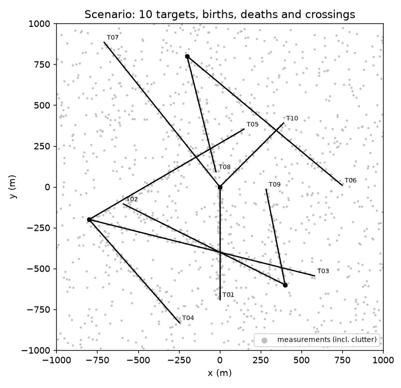
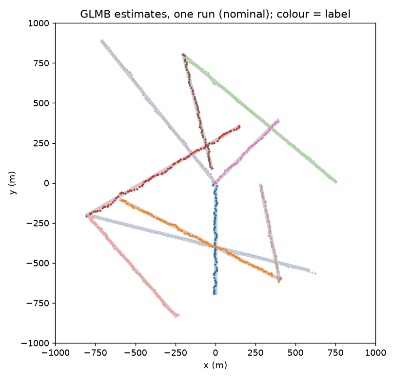
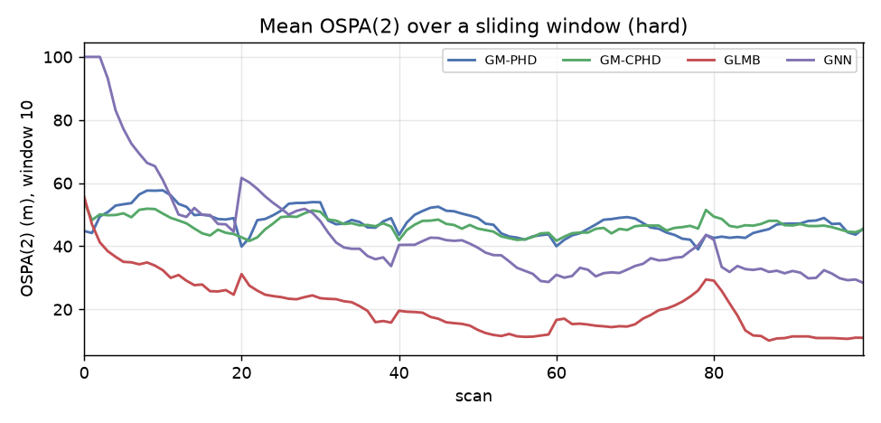
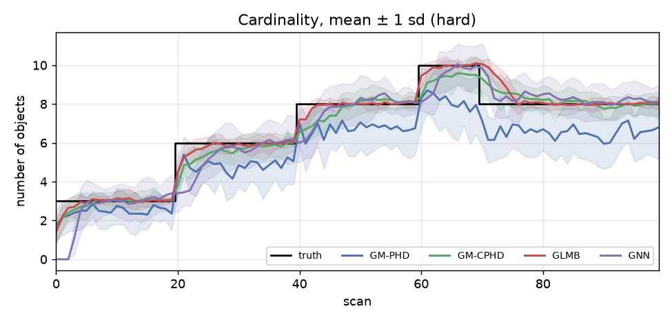

# rfs-mtt-bench

Random finite set (RFS) multi-target trackers in Python, with a reproducible Monte Carlo
benchmark scored by OSPA and OSPA(2).

The package implements three RFS filters and a classical baseline behind one interface:

| Tracker | What it propagates | Identities | Reference |
|---|---|---|---|
| **GM-PHD** | first moment (intensity) of the multi-target posterior | tag propagation | Vo & Ma, IEEE TSP 2006 |
| **GM-CPHD** | intensity + full cardinality distribution | tag propagation | Vo, Vo & Cantoni, IEEE TSP 2007 |
| **δ-GLMB** | full labeled multi-target posterior (joint prediction-update, Gibbs sampling) | labels are part of the state | Vo, Vo & Hoang, IEEE TSP 2017 |
| **GNN** | one Kalman filter per track, optimal 2-D assignment, M-of-N track logic | track IDs | Blackman & Popoli, 1999 |

Every tracker exposes `step(Z, k) -> Estimate(states, labels)`, so they run on the same
scenarios and are scored with the same metrics.

**In brief:** GLMB is the most accurate tracker in both conditions tested, at by far the highest
computational cost (about 100–180 times GNN's run time). Its weak point is identity: in the nominal case it has
more ID switches than GNN (4.0 against 0.6 per run), and most of them come from two targets
born at the same point, T04 and T05 (94 % of GLMB's switches in the nominal case, 68 % in
the hard case).

Background, design decisions, parameters and sources are in [docs/DESIGN.md](docs/DESIGN.md).

## Results

Ten targets in a 2 km × 2 km region over 100 scans, with staggered births and deaths, a
three-way crossing at scan 40 and two targets born at the same point at scan 20.
20 Monte Carlo runs per condition (`rfsmtt-bench --runs 20`).

<p align="center">
  
  
</p>

**Nominal:** P_D = 0.95, 10 false alarms per scan, σ = 10 m

| Tracker | Mean OSPA (m) | Mean OSPA(2) (m) | Cardinality MAE | ID switches | Tracks reported | Run time (GNN = 1) |
|---|---:|---:|---:|---:|---:|---:|
| GM-PHD | 13.5 | 27.1 | 0.42 | 5.8 | 23.0 | 3 |
| GM-CPHD | 11.3 | 24.6 | 0.23 | 3.8 | 22.5 | 19 |
| GLMB | **8.7** | **13.7** | **0.09** | 4.0 | 12.8 | 179 |
| GNN | 14.8 | 22.9 | 0.44 | **0.6** | 10.7 | 1 |

**Hard:** P_D = 0.80, 30 false alarms per scan

| Tracker | Mean OSPA (m) | Mean OSPA(2) (m) | Cardinality MAE | ID switches | Tracks reported | Run time (GNN = 1) |
|---|---:|---:|---:|---:|---:|---:|
| GM-PHD | 29.6 | 47.7 | 1.39 | 6.5 | 33.8 | 3 |
| GM-CPHD | 20.4 | 46.6 | 0.53 | 5.7 | 39.9 | 22 |
| GLMB | **12.3** | **20.6** | **0.26** | **4.5** | 14.2 | 105 |
| GNN | 26.4 | 43.6 | 0.93 | 6.0 | 29.9 | 1 |

<p align="center">
  
  
</p>

What the numbers show:

- **The GLMB filter is the most accurate in both conditions**, and its advantage grows as
  detection gets worse and clutter gets denser: in the hard case its OSPA(2) is less than half
  that of every other tracker. It is also 100 to 180 times slower than GNN in this pure-Python
  implementation.
- **CPHD fixes PHD's cardinality** (MAE 1.39 → 0.53 in the hard case) but not its track
  continuity: OSPA(2) barely moves, because neither filter models identity.
- **GNN is a strong baseline when detection is good.** Its M-of-N confirmation delays and
  filters track starts, which keeps identity switches low in the nominal case, but it degrades
  sharply under dense clutter and missed detections.
- **Most GLMB ID switches come from targets T04 and T05** (94 % nominal, 68 % hard; counted
  with `tools/switch_attr.py`), which are born at the same point in the same scan. A likely
  cause is that the fixed birth model has one birth component per location, so the second
  target is born a scan later and the two labels can trade places while the targets still
  overlap. GNN shows fewer switches here, probably because it confirms tracks four scans later
  and so does not report the short-lived tracks that create switches. Neither explanation has
  been tested yet.

Metrics: OSPA uses c = 100 m, p = 1. OSPA(2) is averaged over a 10-scan sliding window.
ID switches: the number of times the track label matched to a true target changes, summed
over targets and averaged over runs. Matching follows the CLEAR MOT convention: an existing
correspondence is kept while it stays within 50 m, the rest are matched optimally within 50 m,
and a target's first match does not count.

Run times are relative to GNN in the same condition. Absolute times, in ms per scan for GM-PHD /
GM-CPHD / GLMB / GNN: nominal 1.1 / 8.1 / 75.2 / 0.4, hard 2.3 / 18.7 / 90.8 / 0.9. Measured on
an Intel Xeon W-2155 (3.3 GHz; 20 logical CPUs, but the run is effectively single-threaded) with
Python 3.12.3 on an otherwise idle machine. They will differ on other hardware; the ratios are
the more portable figure.

## Quick start

```bash
pip install -e ".[dev]"
pytest -q                                  # unit and integration tests
rfsmtt-bench --runs 20 --out results       # full benchmark, ~7 min (machine above)
rfsmtt-bench --runs 3 --conditions nominal # quick look
```

Tested with Python 3.12.3; exact versions in `requirements-lock.txt`. `tools/` holds two
analysis scripts: `seed_sweep.py` (are the integration tests robust to the seed?) and
`switch_attr.py` (which targets the ID switches come from).

## Using the library

```python
import numpy as np
from rfsmtt import GLMB, AdaptiveBirth, PoissonClutter, constant_velocity

model = constant_velocity(ndim=2, dt=1.0, q=1.0, sigma_pos=10.0, p_d=0.9)
clutter = PoissonClutter(rate=10, bounds=[[-1000, 1000], [-1000, 1000]])
birth = AdaptiveBirth(model, expected_births=0.1, unmeasured_std=20.0)  # births from unexplained detections
tracker = GLMB(model, clutter, birth, h_upd=1000, h_max=1000, rng=0)

for k, Z in enumerate(scans):            # scans: list of (m, 2) detection arrays, one per scan
    est = tracker.step(Z, k)
    print(k, est.labels, est.states[:, [0, 2]])
```

Models are linear-Gaussian (`F, Q, H, R`) of any dimension; `constant_velocity(ndim=1,
sigma_vel=...)` gives a range / range-rate tracker.

## Implementation notes

- **Vectorised Kalman algebra.** Prediction and update run on stacks of components
  (`(n, dx, dx)` covariances) with a Joseph-form covariance update.
- **CPHD in the log domain.** Elementary symmetric functions are computed on rescaled
  values and combined with `logsumexp`, so the recursion stays finite with many measurements.
- **GLMB joint prediction-update.** Each hypothesis spawns association samples from a Gibbs
  sampler over a cost matrix of [death | missed | detected] columns; samples are allocated in
  proportion to √(hypothesis weight), duplicates are merged and the track table is rebuilt
  from referenced tracks only.
- **Adaptive birth** (Ristic et al. 2012; Reuter et al. 2014) places new objects at
  measurements the existing tracks did not explain, using the probability that each
  measurement was associated.
- **Tags for PHD filters.** Components carry tags; when one component spawns several
  significant components in a scan, the extras receive fresh tags.

## Repository layout

```
src/rfsmtt/
  kalman.py     vectorised predict/update with gating
  models.py     motion/measurement, clutter, fixed and adaptive birth
  gmphd.py      GM-PHD with tag propagation
  gmcphd.py     GM-CPHD, elementary symmetric functions
  glmb.py       delta-GLMB, Gibbs sampler
  gnn.py        GNN + M-of-N baseline
  metrics.py    OSPA, OSPA(2), CLEAR-MOT identity switches
  scenario.py   ground truth and measurement simulation
  benchmark.py  Monte Carlo CLI and figures
tests/          unit tests (Kalman, ESF, Gibbs, metrics) and tracker integration tests
```

## References

1. B.-N. Vo and W.-K. Ma, "The Gaussian mixture probability hypothesis density filter," *IEEE TSP* 54(11), 4091–4104, 2006. [doi:10.1109/TSP.2006.881190](https://doi.org/10.1109/TSP.2006.881190)
2. B.-T. Vo, B.-N. Vo and A. Cantoni, "Analytic implementations of the cardinalized probability hypothesis density filter," *IEEE TSP* 55(7), 3553–3567, 2007. [doi:10.1109/TSP.2007.894241](https://doi.org/10.1109/TSP.2007.894241)
3. B.-N. Vo, B.-T. Vo and H. G. Hoang, "An efficient implementation of the generalized labeled multi-Bernoulli filter," *IEEE TSP* 65(8), 1975–1987, 2017. [doi:10.1109/TSP.2016.2641392](https://doi.org/10.1109/TSP.2016.2641392)
4. D. Schuhmacher, B.-T. Vo and B.-N. Vo, "A consistent metric for performance evaluation of multi-object filters," *IEEE TSP* 56(8), 3447–3457, 2008. [doi:10.1109/TSP.2008.920469](https://doi.org/10.1109/TSP.2008.920469)
5. M. Beard, B.-T. Vo and B.-N. Vo, "A solution for large-scale multi-object tracking," *IEEE TSP* 68, 2754–2769, 2020 (OSPA(2)). [doi:10.1109/TSP.2020.2986136](https://doi.org/10.1109/TSP.2020.2986136)
6. B. Ristic, D. Clark, B.-N. Vo and B.-T. Vo, "Adaptive target birth intensity for PHD and CPHD filters," *IEEE TAES* 48(2), 1656–1668, 2012. [doi:10.1109/TAES.2012.6178085](https://doi.org/10.1109/TAES.2012.6178085)
7. K. Bernardin and R. Stiefelhagen, "Evaluating multiple object tracking performance: the CLEAR MOT metrics," *EURASIP JIVP* 2008, article 246309, 2008. [doi:10.1155/2008/246309](https://doi.org/10.1155/2008/246309)

## Author

Eric Tyler, PhD (random finite set multi-target tracking), Curtin University alumni.

MIT licence.
